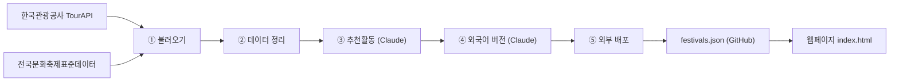

<h1 align="center">전국 축제 캘린더</h1>

<p align="center">
  공공데이터와 AI로 모은 전국 축제를 월별·지역별로 찾아보는 웹페이지<br>
  한국어 · English · 日本語 · 中文
</p>

<p align="center">
  <a href="https://statepark62.github.io/festival/"><b>사이트 열기</b></a>
  &nbsp;·&nbsp;
  <a href="https://statepark62.github.io/festival/data/festivals.json">festivals.json</a>
</p>

---

## 무엇을 하나요

오늘부터 약 6개월 안에 열리는 전국 축제를 한 화면에서 보여 줍니다.

- **월별 분포 띠**: 7개월 탭과 일별 막대로 어느 날 축제가 많은지 한눈에 확인
- **지역 선택 지도**: SVG 지도에서 지역을 눌러 고르고, 여러 지역을 함께 선택. 색이 진할수록 이번 달 축제가 많음. 지도 대신 목록으로 고를 수도 있음
- **검색**: 축제 이름과 지역으로 검색
- **카드와 상세**: 날짜, 장소, 소개문, 추천활동, 지도(Leaflet), 구글·네이버·카카오 지도 링크, 홈페이지, 전화
- **4개 언어**: 한국어, 영어, 일본어, 중국어. 브라우저 언어를 기본으로 하고 선택을 기억하며, 번역이 아직 없는 축제는 한국어로 대신 보여 줌
- **모바일 대응**: 좁은 화면에서는 ‘지도로 지역 선택’이 아래에서 올라오는 창으로 열림. 홈 화면에 추가해 앱처럼 쓸 수 있음

## 어떻게 만들어지나요

서버 없이 구글 시트, Apps Script, GitHub Pages만 사용합니다. 사람이 시트의 메뉴를 한 단계씩 눌러 갱신합니다.



| 단계 | 하는 일 |
|---|---|
| ① 불러오기 | 두 공공 API에서 축제를 받아 시트에 기록. 이미 끝난 축제는 ‘지난축제’로 이동 |
| ② 데이터 정리 | 같은 축제(이름, 시작일, 종료일, 시도, 시군구가 모두 같음)의 중복 행을 합침. 제거한 행은 ‘중복정리’ 시트에 보관 |
| ③ 추천활동 | 소개문에 적힌 내용만 근거로 방문객이 할 수 있는 활동을 AI가 정리 |
| ④ 외국어 버전 | 영어·일본어·중국어 번역. 원문이 바뀐 행만 다시 번역 |
| ⑤ 외부 배포 | 시트 내용을 `festivals.json`으로 만들어 이 저장소에 올림 |

## 폴더 구성

```text
festival/
├─ index.html            # 화면, 스타일, 스크립트를 한 파일에 담은 웹페이지
└─ data/
   └─ festivals.json     # 외부 배포 단계가 만드는 데이터 파일
```

`festivals.json`은 사람이 직접 고치지 않습니다. 시트에서 수정한 뒤 다시 배포하세요.

## 데이터 형식

최상위 항목

| 키 | 설명 |
|---|---|
| `generatedAt` | 파일을 만든 시각 |
| `count` | 축제 수 |
| `coverage` | 언어별(`en`, `ja`, `cn`) 번역이 끝난 축제 수 |
| `festivals` | 축제 목록 |

축제 한 건

| 키 | 설명 |
|---|---|
| `id` | 축제 고유 번호 |
| `name`, `place`, `address` | 이름, 장소, 주소 |
| `start`, `end` | 시작일, 종료일 (`YYYY-MM-DD`) |
| `sido`, `sigungu` | 시도, 시군구 |
| `lat`, `lng` | 위도, 경도 |
| `overview` | 소개문 |
| `homepage`, `tel` | 홈페이지, 전화 |
| `activities` | 추천활동 목록 |
| `i18n` | 언어별 번역(`en`, `ja`, `cn`). 번역 전 축제에는 없음 |

이미 끝난 축제는 배포 파일에 포함하지 않습니다.

## 데이터 출처와 유의 사항

- 한국관광공사 TourAPI(국문 관광정보 서비스)
- 전국문화축제표준데이터 (공공데이터포털)
- 추천활동과 번역은 AI(Claude)가 만들었으므로 사실과 다를 수 있습니다. 일정과 장소는 반드시 각 축제의 공식 안내에서 다시 확인하세요.
- 각 데이터의 이용 조건은 제공처의 안내를 따릅니다.

<details>
<summary><b>운영 메모 (관리자용)</b></summary>

### 월 1~2회 갱신 순서

시트의 ‘데이터 처리’ 메뉴에서 차례로 실행합니다.

1. 불러오기
2. 데이터 정리 (미리보기 확인 후 ‘예’)
3. 추천활동 (새 행만 처리됨)
4. 외국어 버전 (‘남은 번역’이 0건이 될 때까지 반복)
5. 외부 배포
6. 사이트를 강력 새로고침(PC: Ctrl+Shift+R, 아이폰 사파리: 새로고침 길게 누르기)하여 확인

반영에는 배포 후 1~2분이 걸립니다.

### 스크립트 속성 (값은 이 저장소에 두지 않음)

`TOUR_API_KEY`, `STD_API_KEY`, `ANTHROPIC_API_KEY`, `GITHUB_TOKEN`, `GITHUB_REPO`, `GITHUB_PATH`

### 정기 점검

- GitHub 토큰 만료일: 배포가 갑자기 401로 실패하면 먼저 확인
- Anthropic 잔액: 추천활동과 번역이 한꺼번에 실패하면 먼저 확인
- 큰 정리 전에는 시트 파일을 복사해 백업
- 키와 토큰은 코드, 시트, 이 저장소, 화면 캡처 어디에도 남기지 않음

### 비용

공공데이터, 구글 시트·Apps Script, GitHub Pages는 무료이고 Claude API 사용분만 비용이 듭니다.

</details>

## 앞으로 검토 중인 것

- 방문 후기와 별점 (승인 후 공개 방식)
- 관심 축제 찜하기와 모아 보기

## 문의

사용 중 문제나 잘못된 정보는 이 저장소의 Issues에 남겨 주세요.
